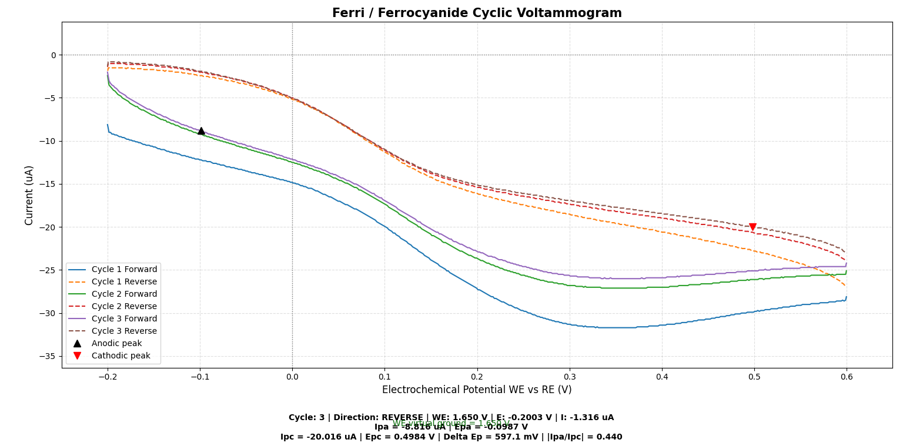

<div align="center">


# ALPHION Potentiostat

**An open, ESP32-based potentiostat for electrochemical sensing and cyclic voltammetry**

[](https://github.com/shreenandansonu/alphion_potentiostat)
[](PCB%20DESIGN/Potentiostat/Potentiostat.pdf)
[](https://www.espressif.com/)
[](PCB%20DESIGN/Potentiostat)
[](https://www.iitm.ac.in/)
[](DOCUMENTATIONS/ALPHION_POTSAT_rev1.pdf)
[](https://alphaion.io/)

[Website](https://alphaion.io/) · [Technical Documentation](DOCUMENTATIONS/ALPHION_POTSAT_rev1.pdf) · [Schematic](PCB%20DESIGN/Potentiostat/Potentiostat.pdf) · [Repository](https://github.com/shreenandansonu/alphion_potentiostat)

</div>

---

## Contents

1. [Overview](#1-overview)
2. [Features](#2-features)
3. [Hardware Architecture](#3-hardware-architecture)
4. [Repository Structure](#4-repository-structure)
5. [Getting Started](#5-getting-started)
6. [Validation and Test Procedures](#6-validation-and-test-procedures)
7. [Running a Cyclic Voltammetry Experiment](#7-running-a-cyclic-voltammetry-experiment)
8. [Results Gallery](#8-results-gallery)
9. [3D Printed Enclosure](#9-3d-printed-enclosure)
10. [PCB Fabrication Files](#10-pcb-fabrication-files)
11. [Documentation](#11-documentation)
12. [Troubleshooting](#12-troubleshooting)
13. [Authors and Acknowledgements](#13-authors-and-acknowledgements)
14. [License](#14-license)

---

## 1. Overview

A **potentiostat** is the core instrument behind most electrochemical measurements. It controls the voltage between a **working electrode (WE)** and a **reference electrode (RE)** while measuring the resulting current flowing through a **counter electrode (CE)**. That current-versus-voltage relationship is what turns a chemical reaction into a readable signal.

**ALPHION** is a compact, fully documented, open-hardware potentiostat built around an ESP32. It was developed from research carried out at **IIT Madras** and is intended as a practical base model for electrochemical sensing, teaching, and rapid experiment prototyping.

The board combines:

- a 12-bit DAC to command the electrode potential,
- an 18-bit ADC (used at 12-bit / 240 SPS in the example firmware) to read the current,
- a low-noise transimpedance amplifier for current-to-voltage conversion,
- a control amplifier and selectable feedback network,
- USB-C power and USB-to-serial communication via an on-board CH340C,
- a power section with separated analog and digital 3.3 V rails.

Everything needed to rebuild, validate and use the system — KiCad sources, Gerbers, firmware, host-side Python tools, test data and an enclosure — is included in this repository.

---

## 2. Features

- **Three-electrode cell support** — WE, RE and CE connections on a dedicated terminal.
- **ESP32-WROOM-32E controller** — two independent I²C buses so the DAC and ADC never contend for the same bus.
- **Wide-range current measurement** — LMP7721 femtoamp-range transimpedance amplifier with selectable feedback via an ADG704 multiplexer.
- **Clean analog supply** — separate `+3.3VA` and `+3.3VD` rails derived from USB-C 5 V through ferrite-isolated LDOs.
- **On-board USB-to-UART** — CH340C gives direct serial plotting from a host PC.
- **Live visualisation** — Python/Matplotlib scripts plot sweeps and cyclic voltammograms in real time and log raw CSV data.
- **Built-in validation path** — loopback jumpers let you check the ADC, DAC and analog front-end without a chemical cell.
- **Reproducible hardware** — KiCad 10 schematic/PCB, complete Gerber set, drill files and 3D enclosure sources.

---

## 3. Hardware Architecture

| Subsystem | Main component | Function |
| --- | --- | --- |
| Controller | ESP32-WROOM-32E | Sweep generation, timing, I²C master, serial streaming |
| Digital-to-analog | MCP4725 (12-bit, I²C `0x60`) | Sets the reference-electrode potential |
| Analog-to-digital | MCP3421 (18-bit ΔΣ, I²C `0x68`) | Digitises the transimpedance amplifier output |
| Control amplifier | OPA2320AIDR | Maintains the working electrode at the commanded potential |
| Transimpedance amplifier | LMP7721MAX | Converts WE current into a measurable voltage |
| Offset generator / buffer | OPA333 | Generates the 1.65 V virtual ground / offset |
| Feedback multiplexer | ADG704BRM | Selects transimpedance feedback range (`MUX_0`, `MUX_1`, `MUX_EN`) |
| USB-to-serial | CH340C | Firmware upload and live data link |
| Power | TLV75533 + TLV73333 LDOs, ferrite beads | Isolated analog and digital 3.3 V rails |

### ESP32 pin map used by the firmware

| Signal | GPIO | Notes |
| --- | --- | --- |
| DAC SDA / SCL | 21 / 22 | `Wire` / `DAC_Wire`, 400 kHz |
| ADC SDA / SCL | 32 / 33 | `Wire1` / `ADC_Wire`, 400 kHz |
| MUX address | 16 / 17 | `MUX_0` / `MUX_1` |
| MUX enable | 18 | `MUX_EN`, active HIGH |
| Internal DAC test output | 25 | Used in `MCP3421_TEST.ino` |
| Internal ADC test input | 35 | Used in `MCP4725_TEST.ino` |
| UART | 1 (TX) / 3 (RX) | Bootloader and serial streaming |

### Electrical conventions in the example firmware

| Quantity | Value |
| --- | --- |
| Working-electrode virtual ground | 1.650 V |
| DAC supply / full scale | 3.300 V (12-bit → 4095 codes) |
| Potential relation | `E(WE vs RE) = 1.650 V − V(DAC)` |
| Feedback resistor (default) | 10 kΩ |
| Current calculation | `I = (V_offset − V_TIA) / R_f` |
| ADC scale in firmware | 1 mV per count at 12-bit, PGA ×1 |
| CV scan rate | 50 mV/s (configurable in firmware) |

> **Note:** the DAC output 1.850 V for `−0.2 V` and 1.050 V for `+0.6 V` (WE vs RE). The inversion is intentional: the DAC drives the reference electrode while the WE is held at the analogue midrail.

---

## 4. Repository Structure

```text
PCB wortk/
├── README.md                         ← this file
├── IMAGES/                           ← hero images and example CV plot
│   ├── Potentiostat.png
│   └── CV.png
├── DOCUMENTATIONS/
│   ├── ALPHION_POTSAT_rev1.pdf       ← full build & test guide
│   └── ALPHION_POTSAT_rev1.docx      ← editable source
├── PCB DESIGN/
│   ├── Potentiostat/
│   │   ├── Potentiostat.kicad_sch    ← schematic
│   │   ├── Potentiostat.kicad_pcb    ← board layout
│   │   ├── Potentiostat.kicad_pro    ← project file
│   │   ├── Potentiostat.pdf          ← schematic as PDF
│   │   ├── Electrode.stp             ← electrode 3D model
│   │   └── Potentiostat-backups/     ← KiCad auto-backups
│   ├── Components/                   ← custom symbol, footprint and STEP models
│   └── FAB/                          ← Gerbers + drill files for fabrication
├── CODES/
│   ├── ADC_DAC_TEST/                 ← I²C bus scanner
│   ├── MCP3421_TEST/                 ← on-board ADC sweep test
│   ├── MCP4725_TEST/                 ← on-board DAC sweep test
│   ├── MCP4725_MCP3421_SYNC_TEST/    ← DAC ↔ ADC loopback
│   ├── RESISTOR_TEST/                ← resistor / dummy-cell measurements
│   ├── RESISTOR_IV_TEST/             ← I–V curve capture and video
│   ├── RANDLE_TEST/                  ← Randles equivalent-circuit check
│   └── Ferro Test/                   ← ferri/ferrocyanide cyclic voltammetry
└── 3D Prints/
    ├── Models.skp / Models.skb       ← editable SketchUp enclosure
    ├── Casing.stl                    ← print-ready mesh
    ├── Casing for ALphionIITM.png
    └── open.png
```

Each experiment folder contains an `.ino` firmware sketch, a matching `.py` host script and, where applicable, an example result image.

---

## 5. Getting Started

### 5.1 What you need

**Hardware**

- ALPHION Potentiostat PCB (assembled) and USB-C cable
- A second ESP32 DevKit **or** a USB-UART adapter for flashing (see [5.3](#53-flashing-the-on-board-esp32))
- For electrochemical runs: WE / RE / CE electrodes and the electrolyte of choice
- For bring-up checks: a few jumper wires and a 10 kΩ resistor

**Software**

- [Arduino IDE](https://www.arduino.cc/en/software) with the **ESP32 boards package** installed
- Python 3.8+ with the plotting stack:

  ```powershell
  pip install pyserial numpy matplotlib
  ```

- [KiCad 10](https://www.kicad.org/) if you want to edit the hardware
- A CH340 USB-serial driver if your operating system does not install it automatically

### 5.2 Identify the serial port

1. Plug in the board (or the external DevKit used for flashing).
2. Open **Device Manager** (Windows) / `ls /dev/tty*` (Linux) and note the COM port.
3. Update `PORT` / `COM_PORT` at the top of the chosen Python script. The shipped scripts use `COM21` as a placeholder, so this step is mandatory.

### 5.3 Flashing the on-board ESP32

The board is programmed through its UART header using an external ESP32 DevKit as a USB-to-UART bridge.

| Step | Action |
| --- | --- |
| 1 | Cross-connect the boards: **External TX0 → Onboard RX0**, **External RX0 → Onboard TX0**, and tie **GND → GND**. |
| 2 | Connect the external DevKit's **EN pin to GND** so only its USB-UART converter stays active. |
| 3 | Plug the external DevKit into the PC and select its COM port in the Arduino IDE. |
| 4 | Arduino IDE settings: **Board = ESP32 Dev Module**, **Upload Speed = 115200**. |
| 5 | Enter bootloader mode on the ALPHION board: **hold BOOT → tap RESET → release BOOT**. |
| 6 | Open the `.ino` sketch and click **Upload**. |
| 7 | Press **RESET** on the ALPHION board to run the new firmware. |

> For later serial data capture, keep the UART connections in place but make sure the two USB-UART transmitters do not drive the line at the same time.

---

## 6. Validation and Test Procedures

Run these in order before attempting a real experiment. Each test builds on the previous one and isolates a different part of the signal chain. Full step-by-step instructions with connection photos are in the [technical documentation](DOCUMENTATIONS/ALPHION_POTSAT_rev1.pdf).

| # | Test | Firmware | Host script | Jumper / setup | What to look for | Example |
| --- | --- | --- | --- | --- | --- | --- |
| 1 | I²C scan | `ADC_DAC_TEST.ino` | Serial Monitor @ 115200 | None | `0x60` (MCP4725) on DAC bus, `0x68` (MCP3421) on ADC bus | [Doc, Fig. 2](DOCUMENTATIONS/ALPHION_POTSAT_rev1.pdf) |
| 2 | ADC sweep | `MCP3421_TEST.ino` | `MCP3421_TEST.py` | Short **DE ↔ AO** | Rising/falling ramp from the ESP32 DAC; removing the jumper gives a flat line | [Plot](CODES/MCP3421_TEST/Test%20Result.png) |
| 3 | DAC sweep | `MCP4725_TEST.ino` | `MCP4725_TEST.py` | Short **DO ↔ AE** | Triangle wave read by the ESP32 internal ADC | [Plot](CODES/MCP4725_TEST/Test%20Result.png) |
| 4 | DAC ↔ ADC loopback | `MCP4725 __MCP3421_SYNC_TEST.ino` | `MCP4725_ MCP3421_SYNC_TEST.py` | Short **DO ↔ AO** | Commanded and measured ramps overlap | [Plot](CODES/MCP4725_MCP3421_SYNC_TEST/Test%20Resuult.png) |
| 5 | Resistor check | `RESISTOR_TEST.ino` | `RESISTOR_TEST.py` | Short **DO ↔ DS**, **AO ↔ AS**, **BF ↔ CO**; connect 10 kΩ across CE/RE and WE | ≈10 kΩ reading; adding a second 10 kΩ in parallel drops it to ≈5 kΩ | [10 kΩ](CODES/RESISTOR_TEST/Test%20Result.png) · [5 kΩ](CODES/RESISTOR_TEST/Test%20Result%205K.png) |
| 6 | I–V curve | `RESISTOR_TEST.ino` | `RESISTOR_TEST_IV.py` | Same as test 5 | Straight line whose slope tracks the resistor value | [Plot](CODES/RESISTOR_IV_TEST/Test%20Results.png) · [Video](CODES/RESISTOR_IV_TEST/IV%20Curves.mp4) |
| 7 | Randles dummy cell | `RANDLE_TEST.ino` | `RANDLE_TEST.py` | Rs = 1 kΩ, Rct = 100 kΩ ∥ Cdl = 100 nF | Near-linear response ≈9.9 µA/V (≈±5 µA at ±0.5 V) | [Plot](CODES/RANDLE_TEST/Test%20Result.png) |
| 8 | Ferri/Ferro CV | `Ferro Test.ino` | `Ferro Test.py` | Real 3-electrode cell (below) | Oxidation/reduction peaks and repeatable cycles | [CV](IMAGES/CV.png) · [2.5 mM](CODES/Ferro%20Test/2.5milimol.png) |

**Jumper shorthand:** `D` = DAC side, `A` = ADC side, `O` = output, `E` = ESP32 internal converter, `S` = summing node, `BF/CO` = buffer/control-amplifier loop. Always power the board off before moving jumpers.

---

## 7. Running a Cyclic Voltammetry Experiment

### 7.1 Prepare the cell

| Item | Recommendation used in the example |
| --- | --- |
| Analyte | 2.5 mM K₃[Fe(CN)₆] + 2.5 mM K₄[Fe(CN)₆] |
| Supporting electrolyte | 0.1 M KCl |
| Working electrode | Carbon |
| Reference electrode | Ag/AgCl (assumed) |
| Counter electrode | Platinum |

### 7.2 Run the measurement

1. Flash `CODES/Ferro Test/Ferro Test.ino` (firmware serial rate: **230400**).
2. Open the serial monitor once to confirm the banner ends with `READY_TO_START`.
   - During calibration the WE must be **disconnected** from the cell; the firmware averages 32 ADC samples to find the zero-current offset.
3. Reconnect WE, RE and CE to the electrode terminal. Double-check that WE and CE are not swapped.
4. Set `PORT` in `CODES/Ferro Test/Ferro Test.py` to your COM port.
5. Start the host script:

   ```powershell
   python "CODES/Ferro Test/Ferro Test.py"
   ```

6. Wait for `READY_TO_START`, then press **Enter** — the script sends `s` to arm the sweep.
7. Watch the live voltammogram. On completion the script prints peak metrics (`Ipa`, `Epa`, `Ipc`, `Epc`, `ΔEp`, `|Ipa/Ipc|`) and writes `Ferri_Ferro_CV_<timestamp>.csv` next to the script.

### 7.3 Keep firmware and host settings in sync

| Setting | Firmware (`Ferro Test.ino`) | Host plot (`Ferro Test.py`) |
| --- | --- | --- |
| Potential window | −0.200 V → +0.600 V | −0.600 V → +0.900 V |
| Cycles | 3 | 5 |
| Scan rate | 50 mV/s | 50 mV/s (display only) |
| Baud rate | 230400 | 230400 |

The firmware values define the **actual** waveform; the Python values only size the plot and the data containers. Edit both files together so the graph matches the experiment.

### 7.4 Serial data format

The firmware streams one CSV row per sampled potential step:

```text
TIME_US,CYCLE,DIRECTION,E_WE_RE_V,WE_MIDRAIL_V,DAC_SIG_V,TIA_V,CURRENT_uA,SAT
```

| Field | Unit | Description |
| --- | --- | --- |
| `TIME_US` | µs | Sample timestamp from `micros()` |
| `CYCLE` | — | 1-based cycle number |
| `DIRECTION` | +1 / −1 | Forward (increasing E) / reverse sweep |
| `E_WE_RE_V` | V | Applied potential, WE relative to RE |
| `WE_MIDRAIL_V` | V | Analogue virtual ground (nominally 1.650 V) |
| `DAC_SIG_V` | V | Actual DAC output voltage |
| `TIA_V` | V | Transimpedance amplifier output |
| `CURRENT_uA` | µA | Calculated cell current |
| `SAT` | 0 / 1 | 1 when the ADC is close to either rail |

Lines beginning with `#` are status messages; `CV_COMPLETE` marks the end of the run. The host script ignores both and stores only numeric rows.

---

## 8. Results Gallery

| Hardware | Cyclic voltammogram |
| :---: | :---: |
|  |  |

| 2.5 mM ferri/ferro | Low concentration |
| :---: | :---: |
|  |  |

| 10 kΩ dummy resistor | 5 kΩ (two 10 kΩ in parallel) |
| :---: | :---: |
|  |  |

| Randles cell response | I–V sweep |
| :---: | :---: |
|  |  |

A full-length recording of the resistor I–V sweep is available as [IV Curves.mp4](CODES/RESISTOR_IV_TEST/IV%20Curves.mp4).

---

## 9. 3D Printed Enclosure

A custom two-part casing keeps the electrode terminal, jumpers and connectors accessible while protecting the board.

| File | Purpose |
| --- | --- |
| [`Models.skp`](3D%20Prints/Models.skp) | Editable SketchUp source |
| [`Models.skb`](3D%20Prints/Models.skb) | SketchUp backup |
| [`Casing.stl`](3D%20Prints/Casing.stl) | Ready-to-slice mesh |

| Closed casing | Open casing |
| :---: | :---: |
|  |  |

---

## 10. PCB Fabrication Files

The board was designed in **KiCad 10.0.3** and all production outputs are included.

- **Editable design:** [`Potentiostat.kicad_sch`](PCB%20DESIGN/Potentiostat/Potentiostat.kicad_sch), [`Potentiostat.kicad_pcb`](PCB%20DESIGN/Potentiostat/Potentiostat.kicad_pcb), [`Potentiostat.kicad_pro`](PCB%20DESIGN/Potentiostat/Potentiostat.kicad_pro)
- **Gerbers (`PCB DESIGN/FAB/`):** front/back copper, solder mask, paste and silkscreen, plus `Edge_Cuts` and the `job` file
- **Drill files:** `Potentiostat-PTH.drl` and `Potentiostat-NPTH.drl`
- **3D models:** `Electrode.stp`, the USB-C connector STEP file, and custom op-amp models under `PCB DESIGN/Components/`
- **Printable schematic:** [`Potentiostat.pdf`](PCB%20DESIGN/Potentiostat/Potentiostat.pdf)

Zip the `FAB/` folder and upload it to your preferred fab house; the job file and drill files complete the package. The `Potentiostat-backups/` folder contains timestamped KiCad snapshots and can be ignored for fabrication.

---

## 11. Documentation

| Resource | Description |
| --- | --- |
| [Technical Documentation (PDF)](DOCUMENTATIONS/ALPHION_POTSAT_rev1.pdf) | 9-page Rev 1 guide: flashing, jumper settings, expected plots and test results |
| [Technical Documentation (DOCX)](DOCUMENTATIONS/ALPHION_POTSAT_rev1.docx) | Editable version of the same guide |
| [Schematic PDF](PCB%20DESIGN/Potentiostat/Potentiostat.pdf) | Full single-sheet schematic with block labels |
| [Alphaion website](https://alphaion.io/) | Broader electrochemical sensing resources |
| [Source repository](https://github.com/shreenandansonu/alphion_potentiostat) | Issues, history and updates |

---

## 12. Troubleshooting

| Symptom | Likely cause | What to try |
| --- | --- | --- |
| `No I²C devices found!` | Missing common ground, wrong SDA/SCL or no power | Re-check wiring, measure `+3.3VA`, run `ADC_DAC_TEST.ino` again |
| `0x60` not detected | MCP4725 unpowered or A0 strap issue | Check the analog rail and the DAC header |
| `0x68` not detected | MCP3421 unpowered or wrong bus | Check `GPIO32/33` and the ADC header |
| Flat line during ADC/DAC test | Loopback jumper removed | Short **DE↔AO** or **DO↔AE** as in [Section 6](#6-validation-and-test-procedures) |
| `TIA offset outside safe ADC range` | WE still connected during calibration, or open electrode lead | Disconnect WE, press RESET, recalibrate |
| `SAT = 1` in the CSV | Cell current too high for the 10 kΩ feedback resistor | Dilute the analyte or select a different feedback range with the ADG704 |
| No COM port appears | CH340 driver missing | Install the WCH CH340 driver and replug |
| Upload fails / times out | ESP32 not in bootloader | Hold **BOOT**, tap **RESET**, release **BOOT**, then upload |
| Garbled serial output | Baud rate mismatch | 115200 for the scanner/ADC test, 230400 for the DAC and CV scripts |
| CV plot has empty extra cycles | Firmware/host cycle counts differ | Match `TOTAL_CYCLES` in both files ([Section 7.3](#73-keep-firmware-and-host-settings-in-sync)) |

---

## 13. Authors and Acknowledgements

Developed from research at the **Indian Institute of Technology Madras (IITM)** by:

- **Bikash Kumar Mishra**
- **Shreenandan Sahu**

Thanks to [Alphaion](https://alphaion.io/) for the electrochemical sensing resources and public knowledge base that accompany this work.

---

## 14. License

No `LICENSE` file is currently included in this repository. The project is shared for research and educational use; please contact the authors through the [repository](https://github.com/shreenandansonu/alphion_potentiostat) before redistributing it or using it in a commercial product.
